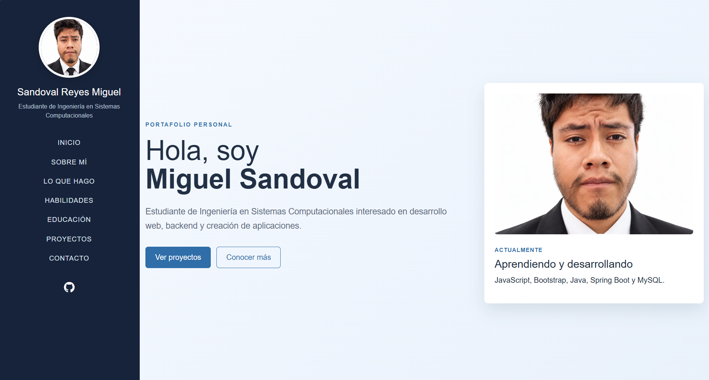
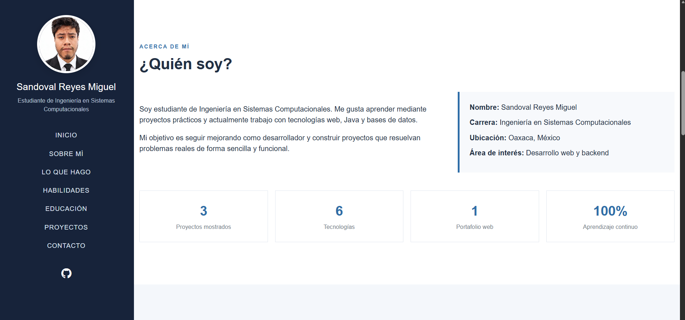
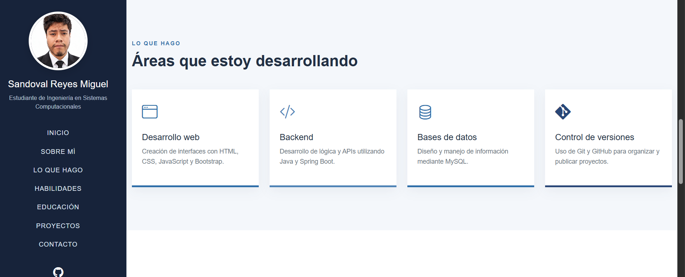
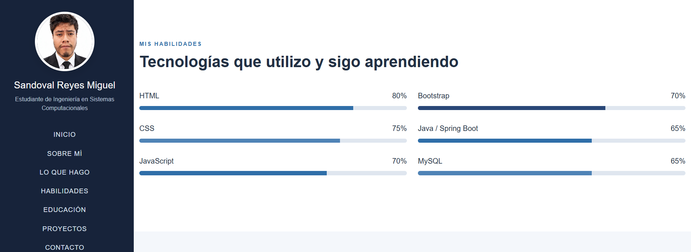
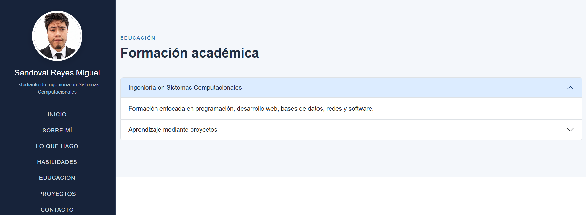
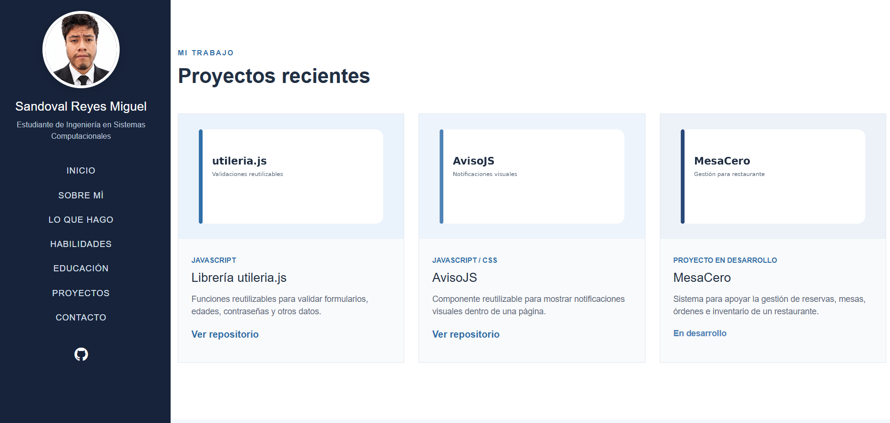
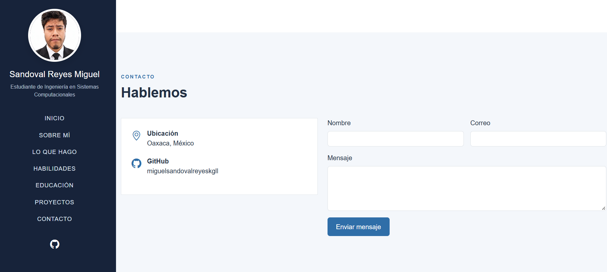

# Actividad 4 - Portafolio Web con Bootstrap

## Portada

**Nombre:** Sandoval Reyes Miguel  
**Materia:** Programación Web  
**Actividad:** Actividad 4. Portafolio Web con Bootstrap o Tailwind  
**Proyecto:** Portafolio Web Personal

---

## Descripción breve

Este proyecto consiste en un portafolio web personal desarrollado con **HTML, CSS, JavaScript y Bootstrap 5**. El objetivo es presentar información académica y personal de una manera ordenada y profesional, incluyendo habilidades, formación, proyectos realizados y una sección de contacto.

El portafolio utiliza una fotografía real de perfil y está organizado como una página de una sola vista con navegación lateral fija.

---

## Plantilla utilizada

Para realizar el portafolio se tomó como referencia la plantilla **Jackson - Free Bootstrap Portfolio Website Template**, disponible en ThemeWagon.

**Página de la plantilla:**  
https://themewagon.com/themes/free-bootstrap-portfolio-website-template/

**Vista previa de la plantilla:**  
https://themewagon.github.io/jackson/

La plantilla fue elegida porque su estructura incluye un menú lateral, presentación personal, información académica, habilidades, proyectos y contacto, elementos que se adaptan bien a un portafolio de estudiante.

---

## Framework utilizado

Se utilizó **Bootstrap 5** como framework CSS principal.

Bootstrap se carga mediante CDN:

```html
<link href="https://cdn.jsdelivr.net/npm/bootstrap@5.3.3/dist/css/bootstrap.min.css" rel="stylesheet">
```

También se utilizaron Bootstrap Icons para algunos elementos visuales:

```html
<link href="https://cdn.jsdelivr.net/npm/bootstrap-icons@1.11.3/font/bootstrap-icons.css" rel="stylesheet">
```

El JavaScript necesario para los componentes de Bootstrap también se carga mediante CDN:

```html
<script src="https://cdn.jsdelivr.net/npm/bootstrap@5.3.3/dist/js/bootstrap.bundle.min.js"></script>
```

Además de Bootstrap, se creó un archivo propio `portafolio.css` para personalizar colores, tamaños, espacios, menú lateral, tarjetas y diseño responsive.

---

# Secciones del portafolio

## Inicio

La sección de inicio presenta el nombre del estudiante, una descripción breve, botones de navegación y una fotografía profesional.

También muestra las tecnologías que actualmente se están aprendiendo y utilizando.



---

## Sobre mí

Esta sección contiene una presentación personal con información sobre la carrera, ubicación y área de interés.

También se agregaron cuadros con datos resumidos como cantidad de proyectos, tecnologías utilizadas y aprendizaje continuo.



---

## Lo que hago

La sección muestra las principales áreas relacionadas con el desarrollo de software que se están trabajando actualmente:

- Desarrollo web
- Backend
- Bases de datos
- Control de versiones

Cada área se presenta mediante una tarjeta con un ícono, título y descripción.



---

## Habilidades

La sección de habilidades muestra algunas tecnologías que se utilizan o se están aprendiendo:

- HTML
- CSS
- JavaScript
- Bootstrap
- Java / Spring Boot
- MySQL

Para representar visualmente el nivel de aprendizaje se utilizaron barras de progreso de Bootstrap.



---

## Educación

La sección de educación presenta información sobre la formación en Ingeniería en Sistemas Computacionales.

Se utilizó un **acordeón de Bootstrap** para poder abrir y cerrar la información de cada apartado.



---

## Proyectos

En esta sección se muestran proyectos realizados o actualmente en desarrollo.

### Librería utileria.js

Librería JavaScript con funciones reutilizables para validar formularios, contraseñas, edades y otros datos.

### AvisoJS

Componente visual reutilizable que permite mostrar notificaciones de éxito, error, advertencia e información dentro de una página.

### MesaCero

Proyecto en desarrollo orientado a la gestión de un restaurante, incluyendo reservas, mesas, órdenes e inventario.



---

## Contacto

La última sección contiene información de ubicación, cuenta de GitHub y un formulario con campos para nombre, correo y mensaje.

El formulario funciona como demostración visual. Al enviarlo, JavaScript muestra un mensaje de confirmación sin recargar la página.



---

# Proceso de creación

## 1. Selección de la plantilla

Primero se buscó una plantilla de portafolio basada en Bootstrap que tuviera una estructura clara y que permitiera mostrar información personal, habilidades, proyectos y contacto.

Se eligió **Jackson**, disponible en ThemeWagon, principalmente por su menú lateral y su organización en secciones dentro de una misma página.

---

## 2. Revisión de la estructura

Se identificaron las partes principales de la plantilla que podían utilizarse como referencia:

- Menú lateral
- Presentación personal
- Información sobre el usuario
- Habilidades
- Formación académica
- Proyectos
- Contacto

A partir de esta estructura se organizaron las secciones necesarias para la actividad.

---

## 3. Organización de archivos

El proyecto se organizó siguiendo la estructura solicitada:

```text
Actividad4_Portafolio/
├── README.md
├── index.html
├── css/
│   └── portafolio.css
├── js/
│   └── portafolio.js
└── img/
    ├── perfil.jpg
    ├── proyecto-utileria.png
    ├── proyecto-aviso.png
    ├── proyecto-mesacero.png
    ├── im1.png
    ├── im2.png
    ├── im3.1.png
    ├── im3.2.png
    ├── im4.png
    ├── im5.png
    └── im6.png
```

Esto permite mantener separados el contenido HTML, los estilos, el JavaScript y las imágenes.

---

## 4. Adaptación del contenido

El contenido de la plantilla fue sustituido por información propia.

Se modificaron:

- Nombre del estudiante
- Fotografía de perfil
- Carrera
- Ubicación
- Descripción personal
- Habilidades
- Formación académica
- Proyectos
- Enlaces de GitHub
- Información de contacto

La fotografía utilizada en el portafolio es una fotografía real y formal.

---

## 5. Modificación de colores y estilos

Se creó el archivo:

```text
css/portafolio.css
```

para personalizar el diseño.

Se utilizó principalmente una combinación de:

- Azul oscuro para el menú lateral
- Azul para botones, títulos y elementos importantes
- Blanco para tarjetas y secciones
- Gris claro y azul claro para fondos

También se modificaron tamaños, separaciones, tarjetas, fotografías y comportamiento responsive.

---

## 6. Uso de Bootstrap

Bootstrap se utilizó para facilitar varias partes de la página.

Algunos ejemplos son:

### Sistema de columnas

```html
<div class="row">
    <div class="col-md-6"></div>
    <div class="col-md-6"></div>
</div>
```

### Barras de progreso

```html
<div class="progress">
    <div class="progress-bar" style="width: 80%"></div>
</div>
```

### Acordeón de educación

```html
<div class="accordion" id="acordeonEducacion">
```

### Formularios

```html
<input type="text" class="form-control">
```

El uso de Bootstrap permitió mantener una estructura adaptable a distintos tamaños de pantalla sin utilizar React, Vue u otro framework de JavaScript.

---

## 7. JavaScript

El archivo:

```text
js/portafolio.js
```

se mantuvo sencillo y se utiliza para pequeñas interacciones.

### Abrir y cerrar el menú en dispositivos pequeños

```javascript
function alternarMenu() {
    document.getElementById("barraLateral").classList.toggle("mostrar");
}
```

### Cerrar el menú después de seleccionar una opción

```javascript
function cerrarMenu() {
    if (window.innerWidth < 992) {
        document.getElementById("barraLateral").classList.remove("mostrar");
    }
}
```

### Formulario de contacto

```javascript
function enviarFormulario() {
    let nombre = document.getElementById("nombreContacto").value;
    let resultado = document.getElementById("resultadoContacto");

    resultado.textContent = "Gracias, " + nombre + ". El formulario funciona como demostración.";
    resultado.className = "mt-3 text-success fw-bold";

    return false;
}
```

El formulario no envía información a un servidor. Se utiliza como demostración de interacción dentro del portafolio.

---

# Modificaciones realizadas respecto a la plantilla

La plantilla original fue utilizada como referencia visual y estructural, pero el contenido y la organización fueron adaptados para esta actividad.

Entre las modificaciones principales se encuentran:

- Cambio del contenido original por información académica propia.
- Uso de una fotografía real y profesional.
- Cambio de la paleta de colores.
- Adaptación del menú lateral al español.
- Creación de una sección de áreas de desarrollo.
- Personalización de habilidades y tecnologías.
- Adaptación de la sección de educación.
- Sustitución de proyectos genéricos por proyectos propios.
- Simplificación del JavaScript para mantenerlo fácil de comprender.
- Organización de los archivos en las carpetas solicitadas por la actividad.
- Uso de Bootstrap 5 mediante CDN.
- Eliminación de dependencias y funciones que no eran necesarias para el portafolio.

---

# Diseño responsive

El portafolio puede visualizarse tanto en computadora como en dispositivos con pantallas más pequeñas.

En computadora, el menú permanece fijo en el lado izquierdo.

En dispositivos pequeños, el menú puede mostrarse u ocultarse mediante un botón controlado con JavaScript.

Esto se complementa con el sistema responsive de Bootstrap y reglas `@media` dentro de `portafolio.css`.

---

# Resultado final

El resultado es un portafolio web personal basado en una plantilla Bootstrap, adaptado con información propia y organizado de acuerdo con los requisitos de la actividad.

El proyecto incluye:

- Fotografía real de perfil
- Menú lateral
- Información personal
- Áreas de desarrollo
- Habilidades
- Educación
- Proyectos
- Contacto
- Bootstrap 5
- CSS personalizado
- JavaScript básico
- Diseño responsive
- Documentación mediante README

---

## Créditos

Plantilla de referencia:

**Jackson - Free Bootstrap Portfolio Website Template**

ThemeWagon:  
https://themewagon.com/themes/free-bootstrap-portfolio-website-template/
